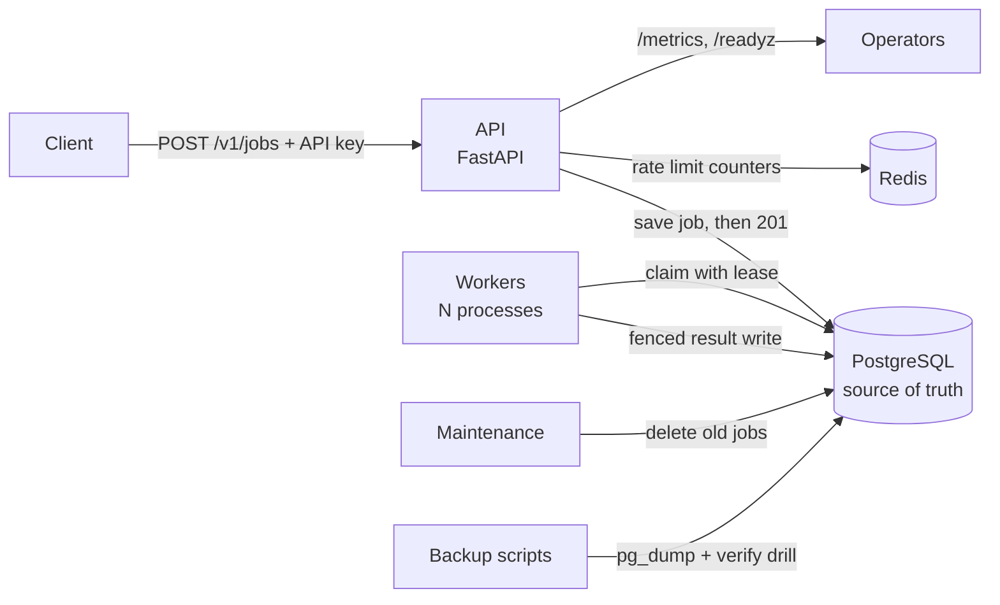

# QueueForge

A distributed job processing platform built with Python, FastAPI and PostgreSQL.
Clients submit jobs over HTTP; separate worker processes claim and execute them
with at-least-once semantics. It is a learning and portfolio project that
focuses on correct, explainable backend engineering.

> **Status:** feature-complete for a single-host deployment: submit, run, retry,
> recover, dead-letter, rate-limit, observe, clean up and back up. It is **not**
> validated in production (see [Limitations](#limitations)). The system is
> **at-least-once**: a job can run more than once, so handlers must be idempotent.
> Docs: [architecture](docs/architecture.md) · [operations](docs/operations.md) ·
> [security](docs/security.md) · [benchmarking](docs/benchmarking.md) ·
> [demo walkthrough](docs/demo.md) · [decision records](docs/decisions/README.md) ·
> [project brief](docs/project-brief.md).

## How it works



- The API only stores jobs; it never runs them. A job is acknowledged only after it is committed.
- Workers claim jobs inside PostgreSQL, so two workers cannot take the same job. A claim gives a time-limited lease; a heartbeat renews it, and a sweeper re-queues jobs whose worker died.
- Retries use exponential backoff with jitter; after 5 attempts a job is dead-lettered and an admin can re-queue it.
- Redis is used only for rate-limit counters, never for the queue.

## Implemented

**Core**
- `POST /v1/jobs` and `GET /v1/jobs/{id}` with API-key authentication, per-client isolation (another client's job is `404`) and idempotency keys (same key and body returns the original job for 24 h)
- Allow-listed task types with validated payloads: `echo`, `sleep`, `flaky`, `simulated_notification`
- Separate workers (`python -m queueforge.worker`) using `FOR UPDATE SKIP LOCKED`; every attempt recorded in `job_attempts`; fenced result writes so a worker that lost its lease cannot overwrite a job
- Retries (permanent vs temporary errors, backoff with full jitter), leases with heartbeat, a sweeper for dead workers (tested with a real hard-killed process), dead-lettering and admin re-queue

**Protection and fairness**
- Per-client and global queue limits (`429`/`503` with `Retry-After`), per-key rate limiting with Redis (fails open), 64 KB body limit, generic `500` errors without stack traces
- Fair claiming: workers serve the client with the fewest running jobs first (a small client's wait behind a 3,000-job backlog fell from about 120 s to 0.06 s in the benchmark)

**Operations**
- Structured JSON logs with a field allow-list (payloads and keys are never logged; tested), `GET /metrics` (Prometheus), `/healthz` and `/readyz`
- Data retention: a `maintenance` service deletes old finished jobs in small safe batches; queued and running jobs are never touched
- Backup, restore and a restore drill (`scripts/backup/`): checksums, optional encryption, rotation, a restore that will not overwrite the live database, and a `verify` command that proves a backup works (runbook in [docs/operations.md](docs/operations.md))
- A repeatable benchmark harness (`scripts/benchmark/`); measured results and findings in [docs/benchmarking.md](docs/benchmarking.md)

**Engineering**
- Environment-based configuration with startup validation (no secrets in code), Alembic migrations, Docker Compose stack (PostgreSQL 16, Redis 7, migrate, API, workers, maintenance)
- Tests against real PostgreSQL (never SQLite), Ruff, strict mypy, and GitHub Actions CI

## Prerequisites

- [Docker](https://docs.docker.com/get-docker/) with Compose v2
- [uv](https://docs.astral.sh/uv/) (installs Python 3.12 and the dependencies)

## Setup

```bash
cp .env.example .env          # then edit .env: set a real POSTGRES_PASSWORD
                              # (and the same password inside DATABASE_URL)
docker compose up -d --build            # db, redis, one-time migrate, api, one worker
docker compose up -d --scale worker=4   # run 4 workers instead
curl localhost:8000/healthz   # {"status":"ok"}
curl localhost:8000/readyz    # {"status":"ready"}
```

Stop everything with `docker compose down` (add `-v` to also delete the database volume).

## Development and tests

```bash
uv sync                       # install dependencies into .venv
uv run ruff check .           # lint
uv run ruff format --check .  # formatting
uv run mypy                   # type check
uv run pytest                 # tests
```

Integration tests need a running PostgreSQL and a `TEST_DATABASE_URL` environment
variable pointing at a **separate** database whose name ends in `_test` (the tests
wipe its tables and refuse to run otherwise). Without it they are skipped. The
rate-limit tests also need `TEST_REDIS_URL` (use a separate Redis database number,
for example `/15`; the tests flush it) and are skipped without it.

```bash
docker compose up -d db redis
docker compose exec db psql -U <POSTGRES_USER> -d postgres -c "CREATE DATABASE queueforge_test"
```

Tests run against real PostgreSQL, never SQLite, because later milestones rely on
PostgreSQL-specific locking behaviour. Tip: use `127.0.0.1` rather than `localhost`
in database URLs on Windows; `localhost` made the test suite roughly 13x slower here.

## Using the API

Create a client (the key is shown once; only its hash is stored):

```bash
uv run python scripts/create_client.py my-client
```

Submit and read a job:

```bash
curl -X POST localhost:8000/v1/jobs \
  -H "X-API-Key: <your key>" -H "Idempotency-Key: order-1" \
  -H "Content-Type: application/json" \
  -d '{"task_type":"echo","payload":{"message":"hi"}}'

curl localhost:8000/v1/jobs/<id> -H "X-API-Key: <your key>"
```

| Status | Meaning |
|---|---|
| `201` | Job created |
| `200` | Same `Idempotency-Key` and body: the original job is returned |
| `401` | Missing, wrong or disabled API key |
| `404` | Job not found (or not yours) |
| `409` | `Idempotency-Key` reused with a different body |
| `422` | Invalid request (unknown task type, bad payload) |

## Health endpoints

| Endpoint | Meaning | Depends on the database? |
|---|---|---|
| `GET /healthz` | The process is up | No |
| `GET /readyz` | The service can do useful work | Yes; returns `503` if the database is unreachable |

## Limitations

- At-least-once, **not** exactly-once: after a crash or a slow worker, a job can run twice. Only the stored result is protected (by the lease-token fence); side effects must be made safe by the handler.
- Recovery needs at least one worker running (the sweeper runs inside each worker).
- Retry settings are global (env vars), not per task type. Task time limits are set per task type in code.
- Rate limiting fails open: if Redis is down there is no limit (a deliberate trade-off, see [operations](docs/operations.md)). Failed logins are not rate limited.
- No endpoint to create API clients; use the script above. No key rotation or expiry.
- Backups are snapshots with no point-in-time recovery, and stay beside the database unless you mount another location.
- Job payloads are stored unencrypted until retention deletes them. Retention deletes data for good (no archive). See [security](docs/security.md).
- The Compose file is for local development only (ports bound to localhost, no TLS, no Redis password).
- Performance figures exist but come from **one low-end laptop** and are not capacity numbers; see [docs/benchmarking.md](docs/benchmarking.md) for what was measured, what was found and fixed, and the limits. Not yet validated in any production-like environment.
- **Fairness is approximate beyond 64 clients waiting at once** and means an equal number of running jobs per client, not an equal share of run time. Fair claiming costs a few percent of worker throughput for do-nothing jobs (measured; see [docs/benchmarking.md](docs/benchmarking.md)).

## License

MIT, see [LICENSE](LICENSE).
